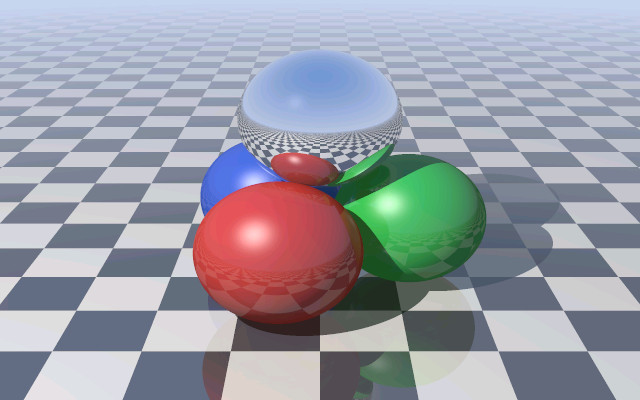
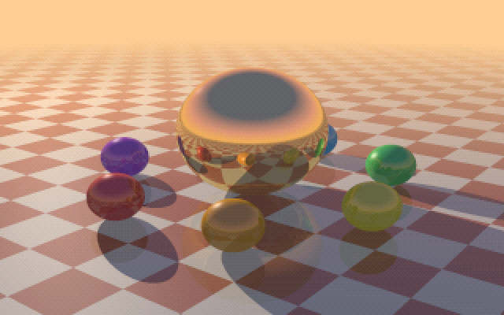

<!--
Copyright (c) 2026 Nakata Maho

Redistribution and use in source and binary forms, with or without
modification, are permitted provided that the following conditions are met:
1. Redistributions of source code must retain the above copyright notice,
   this list of conditions and the following disclaimer.
2. Redistributions in binary form must reproduce the above copyright notice,
   this list of conditions and the following disclaimer in the documentation
   and/or other materials provided with the distribution.

THIS SOFTWARE IS PROVIDED BY THE AUTHOR "AS IS" AND ANY EXPRESS OR IMPLIED
WARRANTIES, INCLUDING, BUT NOT LIMITED TO, THE IMPLIED WARRANTIES OF
MERCHANTABILITY AND FITNESS FOR A PARTICULAR PURPOSE ARE DISCLAIMED. IN NO
EVENT SHALL THE AUTHOR BE LIABLE FOR ANY DIRECT, INDIRECT, INCIDENTAL,
SPECIAL, EXEMPLARY, OR CONSEQUENTIAL DAMAGES (INCLUDING, BUT NOT LIMITED TO,
PROCUREMENT OF SUBSTITUTE GOODS OR SERVICES; LOSS OF USE, DATA, OR PROFITS;
OR BUSINESS INTERRUPTION) HOWEVER CAUSED AND ON ANY THEORY OF LIABILITY,
WHETHER IN CONTRACT, STRICT LIABILITY, OR TORT (INCLUDING NEGLIGENCE OR
OTHERWISE) ARISING IN ANY WAY OUT OF THE USE OF THIS SOFTWARE, EVEN IF
ADVISED OF THE POSSIBILITY OF SUCH DAMAGE.
-->

# 88VA Eternal Grafx Rel.20261122 (M161)

Changes since Rel.20261025, through the explicitly accepted M161 scope.
This is not a claim that all outstanding emulator issues are resolved.

<table align="center" width="100%">
<tr>
<td align="center" width="50%"> <em>HyPER-FRAME+ (V3, 640x400 full colour): ray-traced spheres</em></td>
<td align="center" width="50%"> <em>HyPER-FRAME+: Mandelbrot set, Seahorse valley</em></td>
</tr>
<tr>
<td align="center" width="50%"> <em>Video Art Board (V2, 320x200 65536 colours): sphere ring</em></td>
<td align="center" width="50%"> <em>Video Art Board: Mandelbrot set, Elephant valley</em></td>
</tr>
</table>

The pictures are emulator screenshots of the sample disks in
`demos/hyperframe+` and `demos/vab`, whose programs and pictures are built
from this repository.

## Important: new save-state format

**Snapshots saved by Rel.20261025 or earlier do not load in this release.**
Keep the old release with its snapshots, and save new snapshots in a new
slot. There is no automatic migration.

- Snapshots now restore the BMS board and all its RAM, all FDD, SASI and
  SCSI slots (including empty ones), the PC-8001 family state, and the
  HyPER-FRAME+ and Video Art Board memories.
- Disks are recognised by their contents, not only their file names. A
  missing or changed disk is reported instead of being loaded silently.
- A failed save no longer destroys the existing snapshot, and load errors
  are reported as errors.
- Snapshots do not contain the disks themselves: writing to a disk after
  saving can make that snapshot refuse to load.

## Highlights

- **PC-8001mkII and PC-8001mkIISR.** New machine models, implemented after
  a compatibility review of X88000: graphics, ROM banks, N/N80/N80SR BASIC
  startup, PCG sound and snapshots. Set the CPU clock to 4 MHz for the
  original PC-8001 speed, without sound underflow.
- **A uPD780C main CPU for the PC-8801 and PC-8001 families.** These
  machines (not the VA/VA2 in V1/V2 mode) now run their main CPU on their
  own uPD780C core instead of the VA's uPD70008-compatible mode. The VA and
  VA2 keep the uPD9002's uPD70008-compatible mode for V1/V2.
- **NEC PC-8801-17 Video Art Board.** The 320x200 65536-colour board after
  X88000 1.5.3. Turn it on with the menu item "PC-8801-17 ビデオアートボード"
  (off by default). `demos/vab` has a self-booting sample disk with a
  ray-traced picture and a Mandelbrot close-up for V1/V2 mode.
- **Digital Arts HyPER-FRAME+ (experimental).** A 640x400 24-bit
  frame-buffer board, enabled from the "HyPER-FRAME+..." submenu, with
  ray-traced and Mandelbrot sample programs in `demos/hyperframe+`.
  This work is paused and not yet accepted.
- **Better V1/V2 compatibility.** Several programs that lost their music or
  stopped responding now run:
  - FM music in V2 mode no longer stops when a VRTC interrupt is masked.
  - A sound-timer interrupt is no longer requested again while it is still
    pending, which stalled some programs when a game started.
  - The disk unit's 8255 keeps data sent before a mode change and resets its
    outputs on a mode word; the FDC reports seek ends and reads starting
    past the last sector like the real controller. Some programs that froze
    while loading now continue.
- **TSP sprites and text as on the real VA and VA2.** Sprites appear only
  after the display is on, a line shows a limited number of sprite images,
  sprite overflow and the VA's vertical blanking length follow the machine,
  and text VRAM accesses wait as on the hardware (issue #67,
  `demos/tsp-sprites`).
- **EMS up to 15 MB**, with the page frame only in the bus-slot bank, fixing
  programs that use the system memory banks while EMS is active.
- **Speed display.** The status area shows the real speed, an equivalent CPU
  clock and the guest and drawing frame rates (three-digit rates included),
  with F11 fast-forward and No Wait. The CPU clock menu offers 4, 8, 10, 12
  and 20 MHz.

## Correction to Rel.20261025

Rel.20261025 said that the PC-8801mkIISR demonstration's line drawing
(CARIGRAPH) is black on white on a VA but white on black on a PC-8801mkIISR,
because PC-8801 models ignored the TSP whole-screen reverse with monochrome
graphics. That was wrong: a real PC-8801mkIISR also shows it black on white
(see this [recording of a real machine](https://www.youtube.com/watch?v=OVuNQ11xe9w&t=294s)).
The reverse now applies on every machine and in every graphics mode (M139,
PR #70), so a PC-8801 model shows the drawing as the VA does. The
"PC-8801mkIISR boot: white lines on black" picture of that release does not
show the real machine.

 
<em>PC-8801mkIISR model in this release: CARIGRAPH black on white, as on the real machine</em>

## Other changes

- New settings start with EMS and BMS off, which keeps snapshots small.
  PCG and the VA's N mode default to on when the settings file does not
  mention them; settings you already chose are kept.
- VA CPU (uPD9002): saved flags carry the reserved and mode bits, and
  returns from interrupts select the right mode.
- D88 disks: a track formatted in FM is now recorded as FM, so it reads back
  (for example, copying a disk whose first track is FM no longer fails its
  verification) (PR #84).
- The disk unit's uPD780C is a separate, independently clocked processor,
  and the VA2 disk unit's flag behaviour follows measurements.
- PC-8801 `WIDTH 40` and the original PC-8001 40-column cursor are shown at
  the correct width.
- SASI1 and SASI2 access lamps on the front panel.
- SQEMM98 detects 15 MB of EMS and prints its size correctly.
- Utility disks no longer load the BMS RAM-disk driver when the board is
  absent. The CP/M installer works with lhasa 0.5.
- The window title, About and `--version` show the release date together
  with the build track and the first eight digits of the source commit.
- For developers: frame-scheduled keys and video-register capture in the
  debug script; Windows-native MSYS2 builds; static Windows builds on macOS
  (MacPorts) and on Linux without a container; DOS-based media tools through
  an isolated DOSBox on macOS.

## Known issues and checks not run

- A text-like artifact can appear at scene transitions of the bundled demos
  in VA2/V2H mode (carried forward from M143). On the VA2 model, the
  number of TVRAM writes that fit in vertical blanking is 1.45 times the
  machine's (issue #75, open).
- BRKEM with the direction flag set prints a diagnostic; its behaviour on the
  real machine is still being investigated.
- The planned PC-PR201 printer is not included.
- Visual layout references are still drafts awaiting approval; speed-text
  OCR, macOS Cocoa, physical-GPU and HiDPI checks were not run.

See the [permanent correctness ledger](docs/modernization/bug-fixes.md) for
every fix. Private ROMs, system media, states, captures and personal
codec-enabled binaries are not included in the release. Public builds keep
bundled H.264/AAC encoders off; Windows and macOS use the system encoders.
